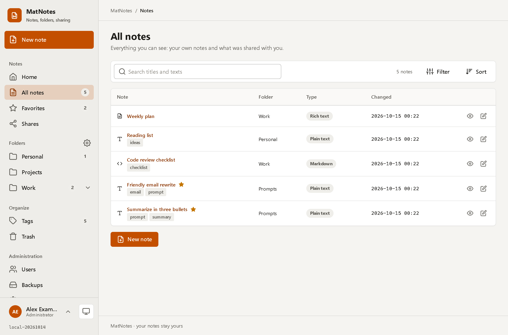

<div align="center">


**Your notes, in folders, private by default, shareable when you decide.**

Rich text, plain text, markdown, Word, Excel, PDF. Tags, links between notes, export in many formats,
sharing with one person or by link, two-step verification, and backups straight to your NAS.

</div>



---

## A look

| | |
|---|---|
|  |  |
|  |  |
|  |  |
|  |  |

## What it is

MatNotes is a small multi-user notes app for your own server. It is made for things you want to find again and sometimes
copy: **a collection of prompts**, snippets, meeting notes, a Word document with the contract next to the PDF of the invoice.

- **Folders and tags.** Folders nest; the menu on the left is the tree of your folders. Tags cut across them.
- **Notes have a type.** *Rich text* (a small editor, no cloud), *plain text* (exactly what you typed: good for prompts),
  *markdown*, and files: *Word (.docx)*, *Excel (.xlsx)*, *PDF* or any other file. A `.txt`/`.md`/`.html` file you upload becomes a text note.
  Word and Excel files are shown as a preview, PDFs in the page.
- **Links between notes.** Put a link to another note into a note. **When you export it (plain text, Word, PDF ...) the linked
  notes are copied into the export**, at the place of the link. Only notes you may read are copied.
- **Export.** A note as `.txt`, `.md`, `.html`, `.rtf`, `.docx`, `.pdf` or `.json`; a workbook as `.csv`; a whole folder as a zip.
- **Sharing** on the level of a note *or* a folder (with everything inside it):
  - with **one user** by user name (read, or read and edit), or
  - with **anyone who has a link** (the *anonymous* role): read only, optional password, optional end date, optional ban on downloads.
  - You see everything you shared on one page (*Shares › Shared by me*) and everything shared with you (*Shared with me*).
- **Privacy.** A user **never sees another user**: there is no list of users, no suggestions, no avatars of others. You share with a person by
  typing their exact user name. Administrators manage accounts, but **cannot read the notes of others**.
- **Sign-in.** Local accounts, roles *Administrator* and *User*, **TOTP** two-step verification (any authenticator app) with recovery codes,
  a lock after repeated failures, sessions you can see and end, and sessions that survive a restart of the container.
- **Trash.** A deleted note waits in the trash (30 days by default) and can be restored.
- **Backups.** Scheduled backups (hourly, daily, weekly, monthly or any cron expression) to a **folder or directly to a NAS over SMB**, with
  **retention** (keep the last N, one per day / week / month), a history, download and restore. See [Backups](#backups).
- **Look.** The design of all Mat apps ([MatDesign](../MatDesign), the *MatUi* toolkit), in orange. Light, dark or system theme and four colour
  schemes per user, a phone layout, a scrollbar that only shows while you scroll.

## Run it

You need Docker. Then:

```bash
docker compose up -d        # docker-compose.yml: matnote + postgres
```

Open **http://localhost:2301**. The first visit starts the setup assistant, which creates the administrator. That is all: no `.env`, no variables.

| Service | What | Port |
|---|---|---|
| `matnote` | the app (ASP.NET Core, Razor Pages) | **2301** |
| `postgres` | the database (PostgreSQL 17, not reachable from outside) | – |

Two volumes hold everything: `matnote-data` (`/data`: the JSON configuration, the keys that protect sessions and secrets) and `matnote-db` (the database).
The image is `ghcr.io/real-ttx/matnote` (`latest` = release, `nightly` = development). Behind a reverse proxy (Caddy, nginx, Traefik) set the **public address**
on *Administration › System*, so that shared links get the right address; `X-Forwarded-*` headers are understood.

Useful environment variables of the `matnote` service: `TZ` (time zone of dates and schedules, default `Europe/Berlin` in the compose file),
`MATNOTE_DB` (the connection string), `MATNOTE_DATA` (the data directory, `/data`). The database password defaults to `matnote`; set `MATNOTE_DB_PASSWORD`
when you start the stack to use another one (the database is not published, so the default is only reachable inside the stack).

## Develop

```powershell
./scripts/redeploy.ps1          # rebuild the image and redeploy the dev stack (always do this to test a change)
./scripts/redeploy.ps1 -Clean   # the same with empty volumes: the setup assistant again
```

The dev stack (`docker-compose.dev.yml`) is `matnote` + `postgres` + **pgAdmin** (http://localhost:2302, no sign-in, database password `matnote`).
`dotnet build MatNote.slnx` and `dotnet test` need only the .NET 10 SDK. [CLAUDE.md](CLAUDE.md) describes the architecture and the conventions.

**Versions** come from `Directory.Build.props` and the GitHub action: a push to `main` builds a **release** (`0.1.<run>-<date>`), a push to `dev` a
**nightly** (`nightly-<run>-<date>`), a local build is `local-<date>`. The version is shown at the bottom of the menu.

## Backups

*Administration › Backups.* A **target** is where backups go: a **folder** (also a NAS that is mounted into the container, path `/backups`) or an **SMB share**
(a NAS, a Windows share, Samba: host, share, user, password; no mount needed). A **schedule** says what runs when, to which target, and how long backups are kept.
One backup is one zip: the database (`pg_dump`), the JSON configuration and, optionally, the encryption keys (needed to read two-step secrets and NAS passwords
after a restore on another machine: then the archive contains everything, so protect the target). *Run now* makes a backup at once; *Restore* brings one back.

## Documents and licences

- The PDF export uses [QuestPDF](https://www.questpdf.com) under its Community licence (free for companies below a revenue limit, for individuals and for non-profits); check that it applies to you.
- The toolkit files in `src/MatNote/wwwroot/matui` are copied from MatDesign; update them by copying again, never edit them.

<details>
<summary>What is where in the data</summary>

PostgreSQL holds the logic: `User`, `UserSession`, `Folder`, `Note`, `NoteFile`, `Tag`, `NoteTag`, `NoteLink`, `Share`, `BackupRun` (PascalCase, key `Id` BIGINT, every row with
`CreateDate`, `CreateUserId`, `UpdateDate`, `UpdateUserId`; a row that can be deleted softly has `UpdateState`: 0 deleted, 1 created, 2 updated). The JSON files in `/data/config`
(`app.json`, `backup.json`) hold the configuration.

</details>
